<picture>
  <source media="(prefers-color-scheme: dark)" srcset="assets/brand/banner-night.svg" />
  
</picture>

[Portfolio](https://juanlara18.github.io/portfolio/) · [Blog](https://juanlara18.github.io/portfolio/blog) · [LinkedIn](https://www.linkedin.com/in/julara/) · [Email](mailto:larajuand@outlook.com)

---

AI Engineer building production AI since 2022. Banking, retail logistics, healthcare AI, academic research. Currently at **Davivienda**. Previously **Falabella**, **GenomAI**, **Harvard**.

My focus is what production demands that papers omit. Scale. Governance. Evaluation.

## Now

- **Davivienda.** Knowledge Data Engineer in the AI First program. I lead the knowledge-base cell: the semantic layer that grounds the bank's AI agents in verifiable, traceable business context.
- **Universidad de los Andes.** M.Sc. in Artificial Intelligence, through 2027.
- **Writing.** The knowledge layer for agents. Ontologies, semantic models, data contracts.

Updated November 2026.

## Selected work

<table>
  <tr>
    <td width="50%" valign="top">
      <a href="https://github.com/JuanLara18/classifai"><strong>classifai</strong></a> 
      Classify any text dataset from one config file. OpenAI, Anthropic or Ollama, with structured outputs, clustering and HTML reports. 
      Python · Pydantic · UMAP · HDBSCAN
    </td>
    <td width="50%" valign="top">
      <a href="https://github.com/JuanLara18/voxscribe"><strong>voxscribe</strong></a> 
      Local transcription and speaker diarization for any audio or video. One CLI, no data leaves the machine. 
      faster-whisper · pyannote · WhisperX · Ollama
    </td>
  </tr>
  <tr>
    <td width="50%" valign="top">
      <a href="https://github.com/JuanLara18/awesome-ai-roadmap"><strong>awesome-ai-roadmap</strong></a> 
      An open roadmap from ML foundations to LLMs, agents and production systems. Curated resources, project ideas, visual paths. 
      Curated · Open source
    </td>
    <td width="50%" valign="top">
      <a href="https://github.com/JuanLara18/bank-agent-llm"><strong>bank-agent-llm</strong></a> 
      Parse bank statements, categorize transactions, explore them in the terminal or a dashboard. Fully offline. 
      Python · Ollama · SQLite · Streamlit
    </td>
  </tr>
</table>

## Writing

180+ engineering notes on production AI. Start with a series: [RAG: From Paper to Production](https://juanlara18.github.io/portfolio/blog/research/rag-retrieval-augmented-generation) · [Agentic AI Engineering](https://juanlara18.github.io/portfolio/blog/field-notes/foundations-of-agentic-ai-llms-to-agents) · [The Knowledge Stack](https://juanlara18.github.io/portfolio/blog/field-notes/data-silos-breaking-information-barriers).

<strong>Background</strong>

 

| Period | Role | |
|---|---|---|
| 2026 to now | Knowledge Data Engineer · AI First | Davivienda |
| 2025 to 2026 | AI Engineer | Falabella |
| 2025 | LLM/ML Specialist | GenomAI |
| 2022 to 2025 | Research Associate · ML Specialist | Harvard University |
| 2024 to 2025 | Data Scientist | Ipsos |

Computer Science + Mathematics dual degree, Universidad Nacional de Colombia, 4.7/5.0.

---

Open to talks, technical engagements, and collaborations on production AI systems.

<a href="mailto:larajuand@outlook.com">larajuand@outlook.com</a>

